<!-- Banner: name, with a typed line underneath -->

  <b>Flutter apps for the warehouse floor, the .NET services behind them, and small tools that make a developer's day easier.</b>

<!-- Stack, in the order I reach for it: mobile, backend, tooling -->

 

<!-- About me: the code on the left, running on the phone on the right -->

  <picture>
    <source media="(prefers-color-scheme: dark)" srcset="assets/about-dark.svg">
    <source media="(prefers-color-scheme: light)" srcset="assets/about-light.svg">
    
  </picture>
  

 

## 📦 Featured Projects

<table>
<tr>
<td colspan="3" width="50%" valign="middle">
  <a href="https://github.com/Potterjr/extendedscreen">
    <picture>
      <source media="(prefers-color-scheme: dark)" srcset="assets/extendedscreen-dark.svg">
      <source media="(prefers-color-scheme: light)" srcset="assets/extendedscreen-light.svg">
      
    </picture>
  </a>
</td>
<td colspan="3" width="50%" valign="middle">
  <h3><a href="https://github.com/Potterjr/extendedscreen">extendedscreen</a></h3>
  Use an Android tablet as a second display for a Mac over USB.
    
  The Mac encodes its screen as H.264 or H.265 and streams it through an <code>adb reverse</code> tunnel; touches come back as mouse input. One Flutter codebase builds both the macOS host and the Android client.
    
  Flutter · Swift · Kotlin
</td>
</tr>
<tr>
<td colspan="2" width="33%" align="center" valign="top">
  <a href="https://github.com/Potterjr/hooktrans">
    <picture>
      <source media="(prefers-color-scheme: dark)" srcset="assets/hooktrans-dark.svg">
      <source media="(prefers-color-scheme: light)" srcset="assets/hooktrans-light.svg">
      
    </picture>
  </a>
   
  <a href="https://github.com/Potterjr/hooktrans"><b>hooktrans</b></a>
   
  Real-time game dialogue translator with a floating overlay, powered by a local LLM.
   
  Flutter · Apple Vision OCR · LM Studio
</td>
<td colspan="2" width="33%" align="center" valign="top">
  <a href="https://github.com/Potterjr/api-to-model">
    <picture>
      <source media="(prefers-color-scheme: dark)" srcset="assets/api-to-model-dark.svg">
      <source media="(prefers-color-scheme: light)" srcset="assets/api-to-model-light.svg">
      
    </picture>
  </a>
   
  <a href="https://github.com/Potterjr/api-to-model"><b>api-to-model</b></a>
   
  VS Code extension: paste a cURL command, get Dart model classes from the response.
   
  TypeScript · VS Code API · Jest
</td>
<td colspan="2" width="33%" align="center" valign="top">
  <a href="https://github.com/Potterjr/file-order">
    <picture>
      <source media="(prefers-color-scheme: dark)" srcset="assets/file-order-dark.svg">
      <source media="(prefers-color-scheme: light)" srcset="assets/file-order-light.svg">
      
    </picture>
  </a>
   
  <a href="https://github.com/Potterjr/file-order"><b>file-order</b></a>
   
  VS Code extension: order files and folders by priority in a sidebar tree.
   
  TypeScript · VS Code API
</td>
</tr>
</table>

 

## 👾 Pac-Man Contribution Graph

> *Waka waka! Pac-Man eats my commits. I keep making more.*

  <picture>
    <source media="(prefers-color-scheme: dark)" srcset="https://raw.githubusercontent.com/Potterjr/Potterjr/output/pacman-contribution-graph-dark.svg">
    <source media="(prefers-color-scheme: light)" srcset="https://raw.githubusercontent.com/Potterjr/Potterjr/output/pacman-contribution-graph.svg">
    
  </picture>

 

## 🤝 Let's Work Together

Building something in Flutter, or need a mobile developer who is comfortable on the backend too? I'd like to hear about it.

<!-- Footer banner -->

